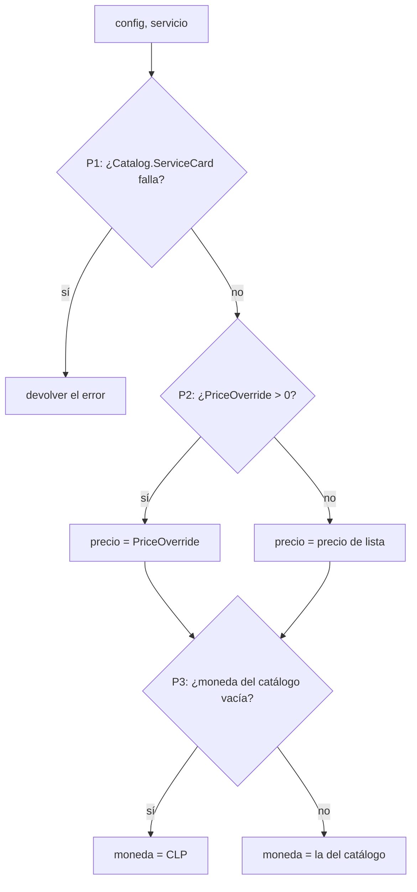
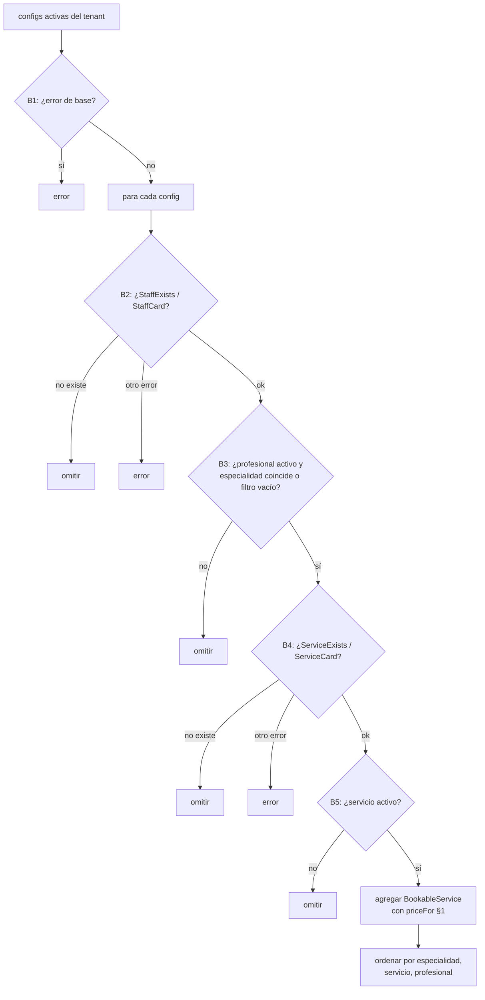
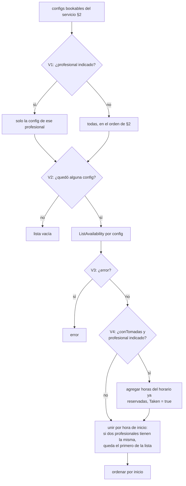
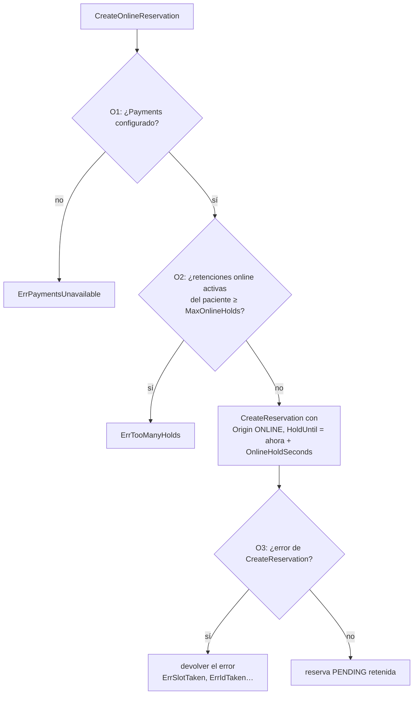
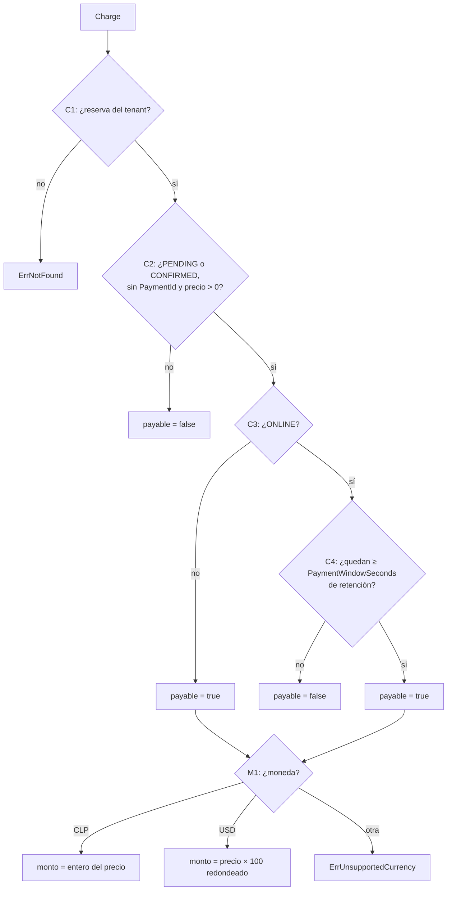
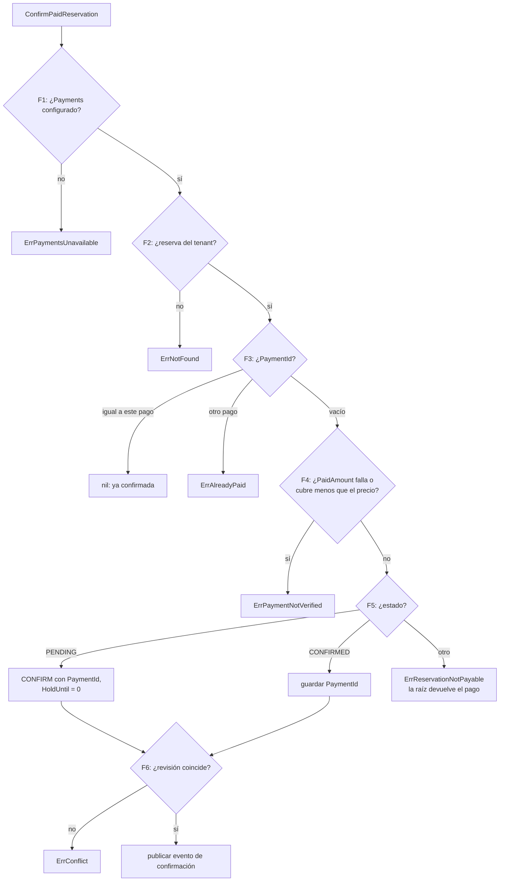
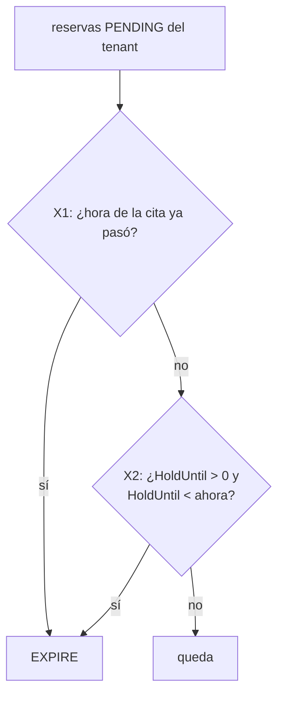

# Reserva en 6 pasos — servidor

Cada rombo lleva un id. La tabla de trazabilidad de [`docs/PLAN.md`](../PLAN.md) §11 asigna a
cada rama su prueba. Una rama sin prueba es un defecto.

## 1. Precio congelado en la reserva (`priceFor`, lo usan crear, sobrecupo y online)

## 2. `ListBookableServices(tenant, especialidad)`

"No existe" se pregunta con `StaffExists`/`ServiceExists`, que lo responden como
`(false, nil)`: el `ErrNotFound` de otro módulo es de otro tipo y no se puede
comparar aquí.

## 3. `ListServiceAvailability(tenant, servicio, profesional, desde, hasta, conTomadas)`

## 4. `CreateOnlineReservation(cmd)`

"Retención activa" = reserva del paciente con `Origin ONLINE`, `Status PENDING` y
`HoldUntil > ahora`.

## 5. `Charge(tenant, reserva)` — lo llama payment_manager

## 6. `ConfirmPaidReservation(tenant, reserva, pago)` — la llama la raíz de composición al recibir `payment.paid`

## 7. `ExpirePendingReservations(tenant, ahora)`

