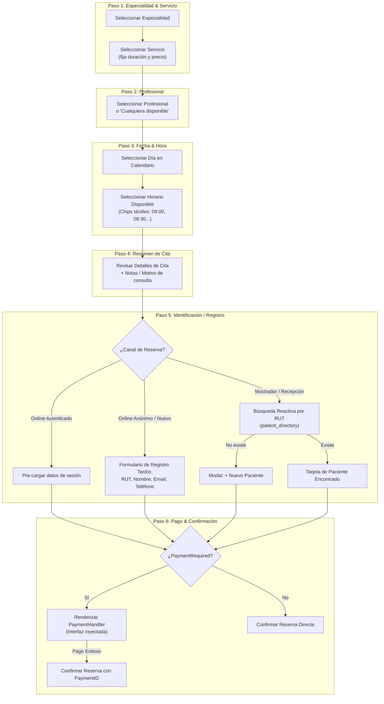
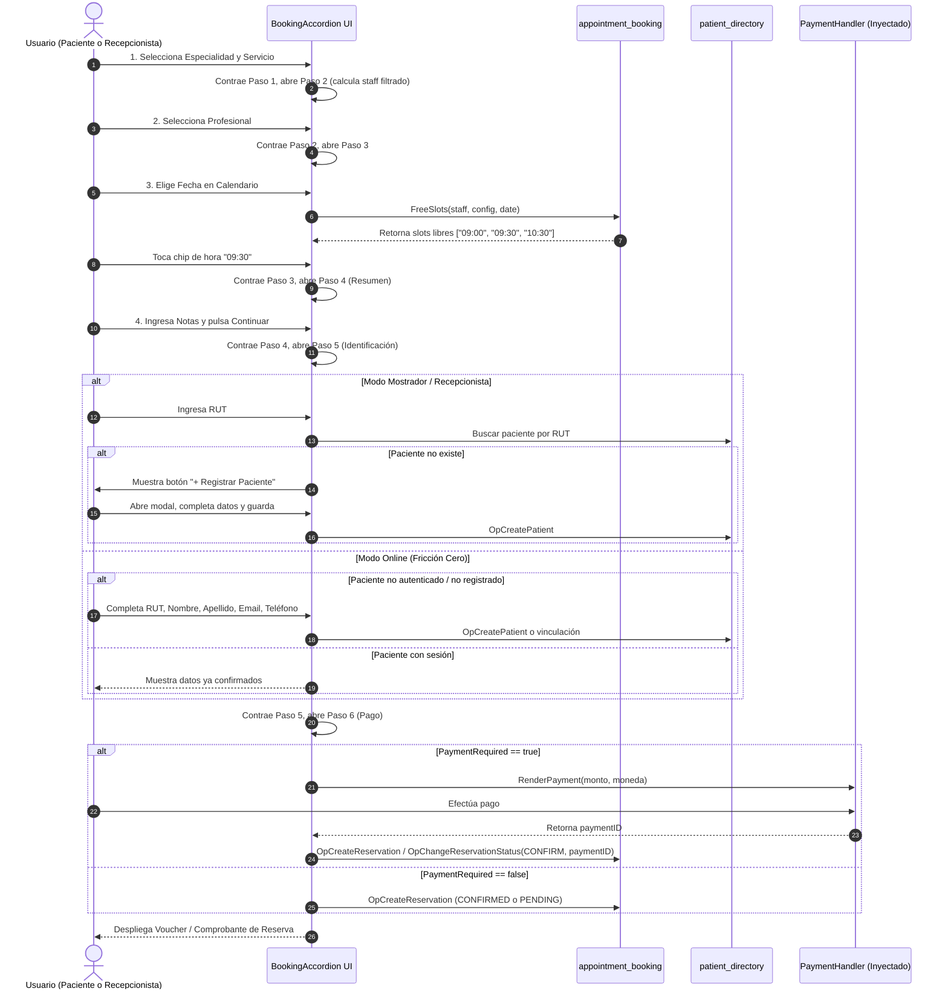

# Diagrama de Flujo de Reserva (Booking Flow) — appointment_booking

Diagrama del embudo de agendamiento en 6 pasos progresivos tipo Acordeón/Wizard.

## 1. Arquitectura del Flujo Progresivo

## 2. Secuencia Detallada (Paciente Online vs Recepcionista)

