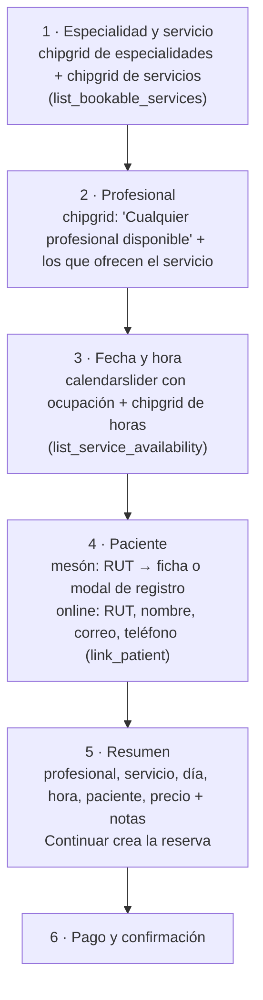
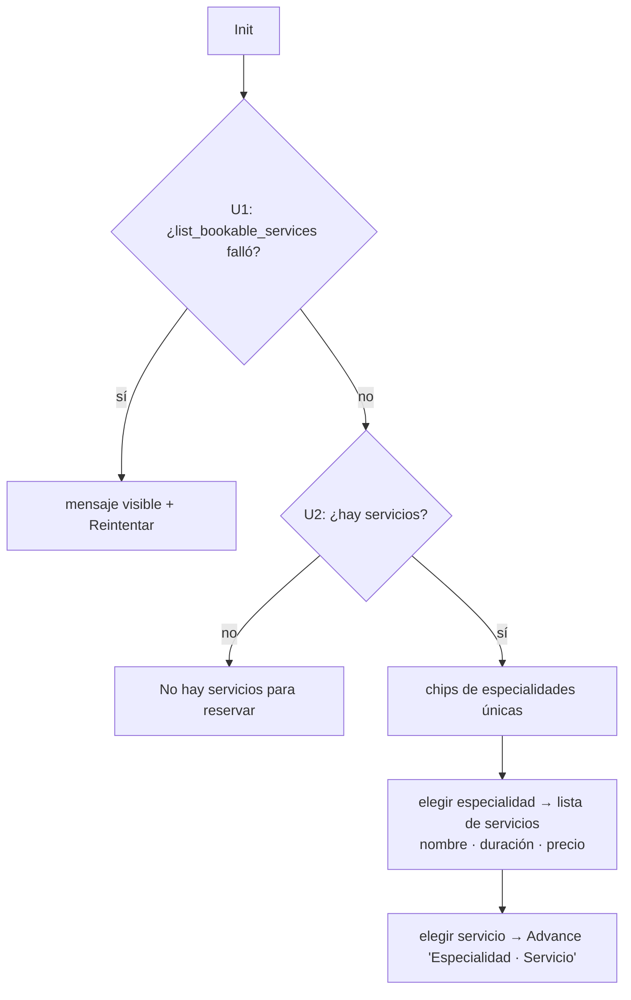
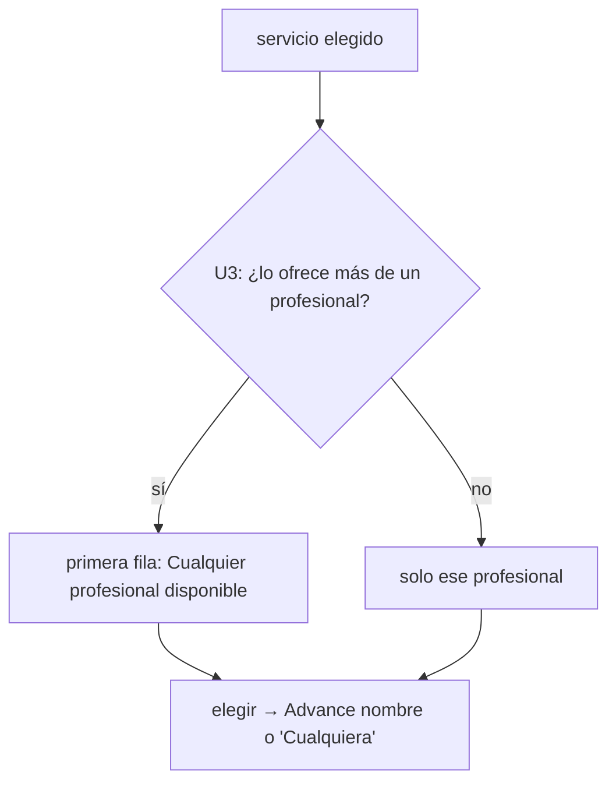
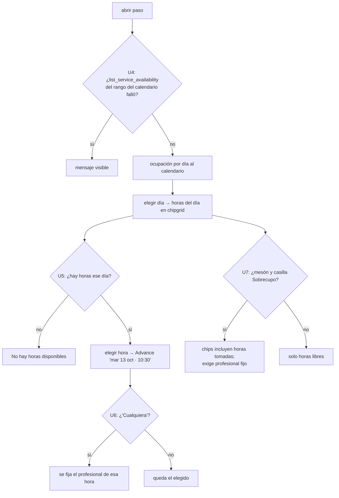
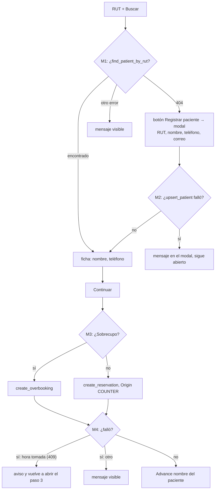
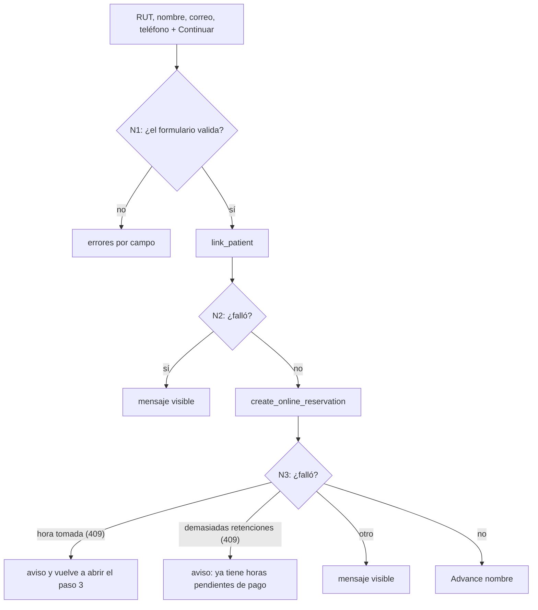
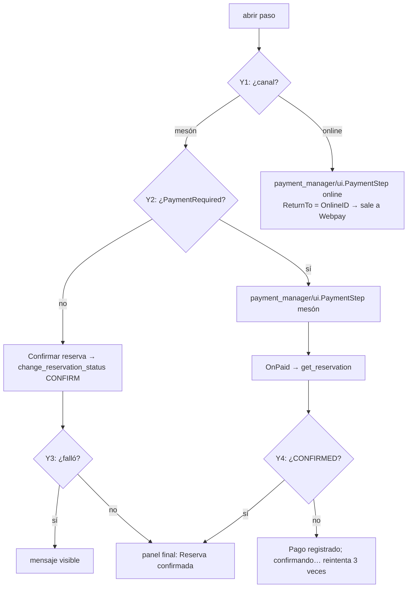
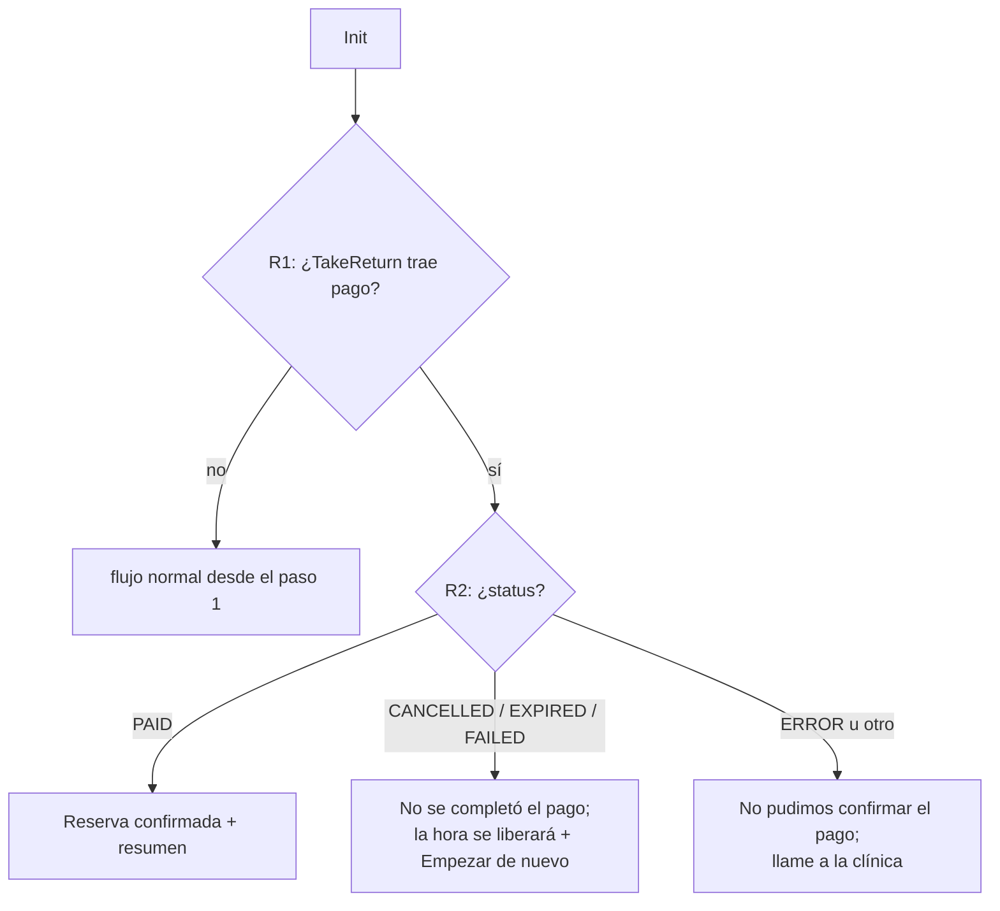

# Reserva en 6 pasos — pantalla

Dos pantallas con el mismo flujo (`ui/booking_flow.go`): **Reserva Hora** (mesón, `ui.Browser`)
y **Reserva online** (paciente invitado, `ui.OnlineBrowser`). Cada rombo lleva un id; la tabla
de trazabilidad de [`docs/PLAN.md`](../PLAN.md) §11 asigna a cada rama su prueba wasm.

## 1. Pasos (`stepaccordion.StepAccordion`)

Reabrir un paso (`Editar`) borra todo lo elegido en los pasos siguientes (`OnReopen`).
El resumen va después del paciente ("revise sus respuestas"): la reserva se crea
recién ahí, con todo a la vista (decisión del 2026-10-13). Servicio y profesional
se eligen con `chipgrid`. Las ramas M3/M4 y N3 (crear la reserva) ocurren en el
paso 5; M1/M2 y N1/N2 (elegir o vincular al paciente), en el 4.

## 2. Paso 1

## 3. Paso 2

## 4. Paso 3

La casilla **Sobrecupo** solo existe en mesón.

## 5. Paso 5 — mesón

## 6. Paso 5 — online

## 7. Paso 6

## 8. Vuelta de Webpay (`OnlineBrowser` al iniciar)

## 9. Panel final

Muestra profesional, servicio, día, hora, paciente y, si hubo pago, el monto con
`paymentmanager.FormatAmount`. Botón **Nueva reserva** reinicia el flujo.
