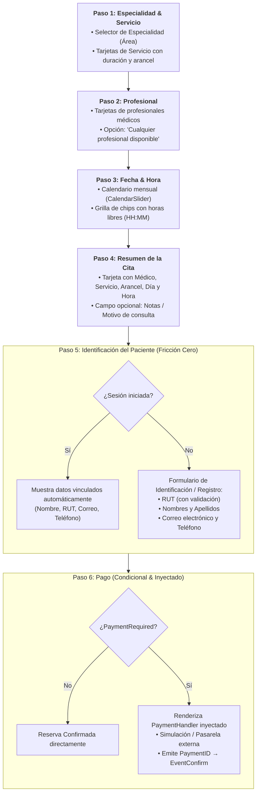

# Plan Maestro: Rediseño del Flujo de Reserva (Acordeón Progresivo) y Sistema de Traducción

## Goal Description
Transformar el agendamiento de citas de un formulario CRUD estático a un **flujo de reserva progresivo (Acordeón Vertical / Wizard de 6 pasos)** alineado con los estándares de la industria (Doctolib, Zocdoc, Reservo), soportando los dos casos de uso:
1. **Paciente Online (Autoservicio)**: Fricción mínima (Guest/Lazy Registration: el registro solo ocurre en el Paso 5 si no está autenticado, seguido de Paso 6 de pago condicional vía interfaz inyectada).
2. **Recepcionista (Mostrador / Mesa de Entrada)**: Operación ágil con búsqueda reactiva por RUT en [`patient_directory`](file:///home/cesar/Dev/Project/veltylabs/modules/patient_directory), creación rápida de pacientes no registrados vía modal y gestión de sobrecupos.
3. **Corrección de Idioma Webtyp**: Activar definitivamente el diccionario español (`default: es`, `lang.OutLang("es")` y etiquetas normalizadas).

---

## 1. El Embudo de Reserva en 6 Pasos (Acordeón Progresivo)

El flujo se despliega verticalmente hacia abajo. Cada paso completado contrae su detalle a un resumen compacto con opción de *"Editar"* y desbloquea el siguiente paso:



---

## 2. Diferenciación por Caso de Uso: Online vs Mostrador

Ambos flujos utilizan el **mismo backend y modelo de datos** (`appointment_booking`), diferenciándose en la capa de presentación:

| Aspecto | Paciente Online (Autoservicio) | Recepcionista (Mostrador / Counter) |
| :--- | :--- | :--- |
| **Punto de Entrada** | Widget público o Portal de Pacientes | Pantalla interna de Recepción |
| **Identificación** | **Al final (Paso 5)** para no espantar la conversión | **Al inicio o en Paso 4** mediante búsqueda por RUT |
| **Búsqueda RUT** | No busca terceros; ingresa sus propios datos | Conectado reactivamente a `patient_directory` |
| **Paciente Nuevo** | Se registra en el Paso 5 con datos básicos | Modal instantáneo `+ Nuevo Paciente` si el RUT no existe |
| **Origen (`Origin`)** | `OriginOnline` (`"online"`) | `OriginCounter` (`"counter"`) |
| **Sobrecupo** | Oculto y bloqueado | Permitido según `MaxOverbookPerDay` |
| **Pago (Paso 6)** | Pasarela online inyectada (`WebPay`, tarjeta, etc.) | Pago en mesón (efectivo/POS) o confirmación diferida |

---

## 3. Arquitectura de Interfaces Inyectadas

### 3.1. Pasarela de Pago (`PaymentHandler`)
Para desacoplar el módulo de cualquier pasarela concreta (Transbank, Stripe, MercadoPago), se define una interfaz de inyección en el módulo:

```go
// PaymentHandler es la interfaz inyectable para el Paso 6.
type PaymentHandler interface {
    // RequiresPayment informa si esta configuración o arancel exige prepago.
    RequiresPayment(cfg EmployeeServiceConfig) bool
    // RenderPayment monta la interfaz de pago y notifica el resultado.
    RenderPayment(amount int64, currency string, onDone func(paymentID string, err error)) *dom.Element
}
```

### 3.2. Directorio de Pacientes (`PatientLookup`)
Para la recepcionista, la búsqueda reactiva se realiza a través del router caller o un lector inyectado hacia `patient_directory`:
* **Input RUT reactivo**: Formatea y valida el dígito verificador.
* **Búsqueda**: Llama a `patient_directory.get_by_rut`.
* **Si existe**: Muestra ficha con Nombre, Teléfono, Previsión (Fonasa/Isapre).
* **Si no existe**: Botón `+ Registrar Paciente` que despliega un `ModalDialog` ligero para guardar en `patient_directory` y retornar el nuevo `patient_id`.

---

## 4. Cambios Propuestos por Componentes

### Componente 1: Sistema de Idioma y Diccionario

#### [MODIFY] [`lang.json`](file:///home/cesar/Dev/Project/veltylabs/modules/appointment_booking/lang.json)
- Configurar `"default": "es"` en la raíz.
- Agregar las claves de componentes y calendario (`Select date`, `Mon`...`Sun`, meses, `Today`).
- Normalizar etiquetas a formato de interfaz: `"client id": ["Paciente"]`, `"hour": ["Hora"]`, `"day": ["Día"]`, `"notes": ["Notas"]`.

#### [MODIFY] [`web/browser.go`](file:///home/cesar/Dev/Project/veltylabs/modules/appointment_booking/web/browser.go)
- Invocar `lang.OutLang("es")` en la inicialización del cliente WASM.

---

### Componente 2: Modelo y Saneamiento de Widgets

#### [MODIFY] [`model.go`](file:///home/cesar/Dev/Project/veltylabs/modules/appointment_booking/model.go)
- En `ReservationFormModel`, sanear `hour` para que su metadata sea `"hour"` (en lugar de `"formato hora: HH:MM"` hardcoded en `input.Hour()`).

---

### Componente 3: Nuevo Componente de Acordeón Progresivo

#### [NEW] [`ui/booking_accordion.go`](file:///home/cesar/Dev/Project/veltylabs/modules/appointment_booking/ui/booking_accordion.go)
- Implementar el widget de acordeón interactivo:
  - **Paso 1**: Área / Servicio.
  - **Paso 2**: Profesional.
  - **Paso 3**: Calendario interactivo con chips de horarios libres calculados por `FreeSlots`.
  - **Paso 4**: Resumen de cita con notas.
  - **Paso 5**: Identificación (Paciente logueado vs formulario nuevo de RUT/contacto).
  - **Paso 6**: Pago condicional vía `PaymentHandler` (o simulador de prueba).

#### [NEW] [`ui/patient_picker.go`](file:///home/cesar/Dev/Project/veltylabs/modules/appointment_booking/ui/patient_picker.go)
- Componente de búsqueda por RUT para el modo recepción, con modal integrado para crear pacientes nuevos en `patient_directory`.

#### [MODIFY] [`ui/bookingview.go`](file:///home/cesar/Dev/Project/veltylabs/modules/appointment_booking/ui/bookingview.go)
- Integrar el nuevo acordeón en la vista principal y habilitar selector de modo (Recepción vs Simulación Online).

---

## Verification Plan

### Automated Tests
```bash
gotest ./...
```
- Verificar que las pruebas de dominio, aislamiento multitenant y lógica de FSM continúan pasando sin regresiones.

### Manual Verification en Navegador
1. **Prueba de Idioma**: Verificar que todos los textos, títulos, meses y días se muestren 100% en español.
2. **Prueba del Flujo Acordeón (Online)**:
   - Seleccionar Especialidad → Servicio → Médico → Día en calendario.
   - Verificar que aparezcan los chips de horarios libres (ej. `09:00`, `09:30`) y que al pulsar uno se seleccione automáticamente sin escribir texto.
   - En el Paso 5, verificar que el paciente anónimo complete RUT y datos de contacto solo al final.
   - En el Paso 6, verificar que si el servicio tiene `PaymentRequired`, se active el contenedor de pago antes de confirmar.
3. **Prueba del Modo Recepción**:
   - Ingresar un RUT de paciente existente y confirmar que se seleccione.
   - Ingresar un RUT inexistente, abrir modal de alta rápida, guardar y confirmar la reserva.
